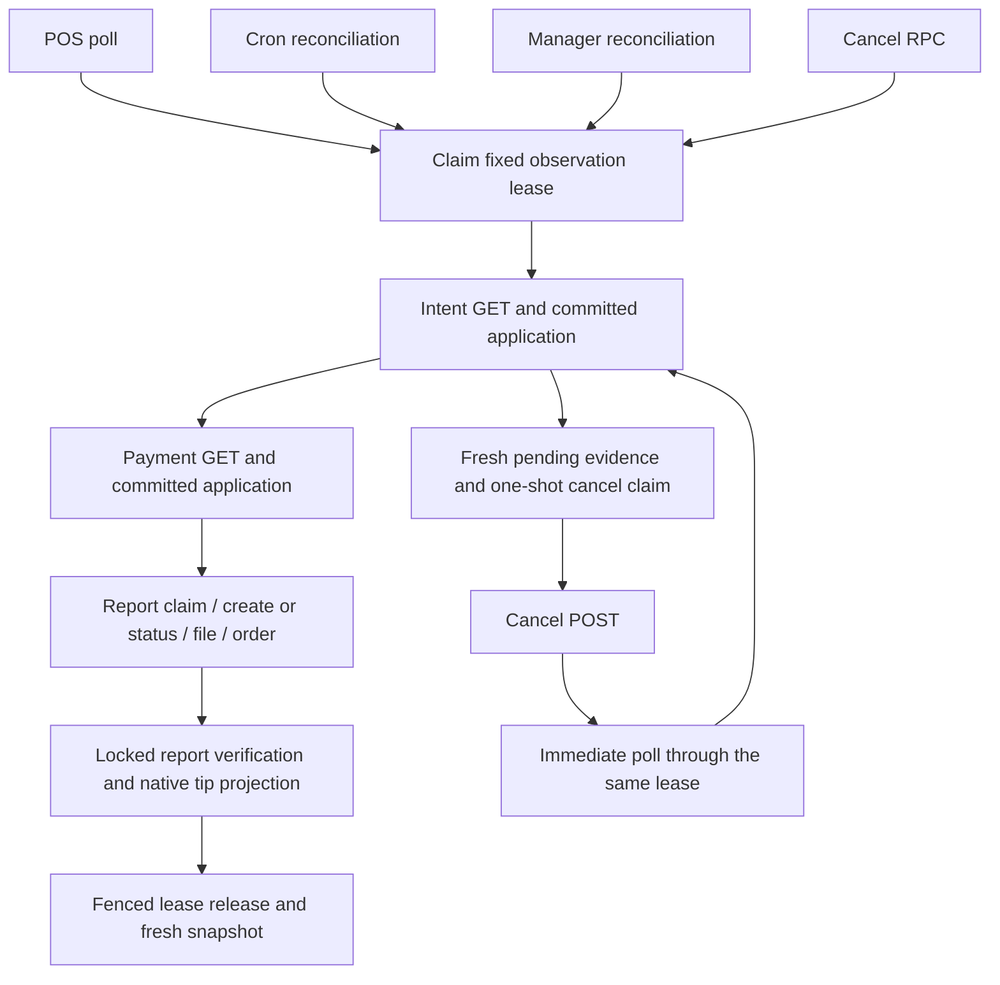

# Payment observation reinforcement

Scope: preserve the public payment RPCs and persisted evidence while making
polling, terminal-tip reporting and cancellation run through one explicit
observation module. Review base: `714422bbb3c27afbbc63360d3f11ac24fb7aa15c`.
The owner approved testing at poll/cancel RPCs and cron/manager reconciliation
with real database transactions and mocked Revolut HTTP.

## Map before changes

The model registration order makes `payment_observation.py` the outer poll
override, followed by `terminal_tip.py`, then `pos_payment_method.py`:

The base poll applies legacy-final recovery, then authenticated intent evidence,
then underlying payment evidence. The tip override proceeds only when this
poll produced valid pending captured/completed evidence. Report creation has
its own durable claim; a run identity must match before applying or retiring
it. Captured money remains reserved until explicit tip evidence, including a
zero tip, verifies gross/base/tip decomposition and projects the native tip.

Cancellation calls the public poll twice. The outer override detects its
ContextVar scope and bypasses a second claim/cadence gate. The precheck, durable
one-shot cancel claim, POST acknowledgement and immediate recovery all use the
original lease and total budget. Manager reconciliation calls this same public
poll, then records its audit independently. Cron calls the public poll and
never applies an unfenced fallback after exhausted transaction conflicts.

Each owned observation application takes the ReturnAllocation locks in this
order: session rows, sorted order identities, native order rows, charge rows,
refund rows. It refreshes evidence, checks the original token and expiry, then
calls the reducer and commits. The reducer also takes that lock order for
transaction adapters such as manager association. No financial locks cover
provider HTTP. Lease claims/releases use separate committed conditional SQL.

## Design and preservation requirements

`payment_observation.py` owns the public poll/cancel interface and explicitly
sequences payment reads, report follow-up and cancellation recovery. Private
phase methods replace public-poll inheritance and recursive re-entry. Keep the
existing Odoo model style, HTTP adapters, report parser and outcome reducer;
no new framework or financial state representation is needed.

The owned application adapter has one transaction retry loop for both scoped
poll evidence and legitimate unscoped dispatch/timeout evidence. Only an active
scope for the same operation adds the token fence and provider deferral.
Manager association retains its caller-owned transaction and audit atomicity.

This module gains depth by hiding sequencing, claim reuse and phase ordering
behind unchanged public RPCs. Its leverage reaches foreground, cancellation,
cron and manager callers; its locality puts observation orchestration and
application fencing in one place. Removing it would force those callers to
reconstruct the claim/budget/report protocol.

Preserve:

- Final financial evidence, retry safety, frozen credential/register authority,
  browser snapshot shape and existing cadence/backoff.
- This poll's validity gate before using retained capture/report evidence.
- A fixed 60-second lease, 20-second payment phase, 30-second report phase and
  50-second total cooperative budget; cancellation shares the total budget.
- Token fencing after potentially blocking financial locks, original-token
  conflict recovery, and conditional lease release.
- Report claim/run identity and atomic verification/native tip projection.
- One-shot cancellation and no financial redispatch during observation.

Also check elapsed budgets after acquiring financial locks: a final report
that completed HTTP within budget must not verify a sale if its evidence
transaction waited until the observation budget expired. Retain the capture,
record interruption under the still-current token, and let a fresh observation
recover the original payment. A stale/expired token still makes no evidence or
schedule change.

The lease and elapsed checks remain cooperative. A blocked socket can outlive
the lease and physically overlap a successor; persisted fencing, rather than
physical single-flight, protects the result.

## Verification

Before edits, all 15 existing payment-observation tests passed. The new
public-RPC regression then failed against the unchanged implementation:
`verified` was returned instead of `unresolved` after the final report
application waited on an actual PostgreSQL session-row lock until the elapsed
budget expired. With the fix, all 16 observation tests pass; a later fresh poll
recovers the original payment without financial redispatch.

| Check | Result |
| --- | --- |
| Observation suite before edits | 15 passed |
| New post-lock budget regression before fix | 1 expected failure |
| Observation suite after reinforcement | 16 passed |
| POS state JavaScript suite | 99 passed |
| Repository Python suite | 53 tests, 3 opt-in cases skipped, no failures |
| Python compilation and `git diff --check` | Passed |
| Full addon clean installation | 563 passed, no failures/errors |
| Full addon upgrade after fixture isolation/reset | 563 passed, no failures/errors, exit 0 |
| Cron-only tip test on isolated install/upgrade | Passed both |
| Cron-only tip test on copied historical-fixture database | Failed before fixture isolation, passed afterward |

The first full upgrade exposed an existing scheduler-test isolation gap:
`test_scheduled_reconciliation_finishes_tip_without_browser` left its operation
pending. That test passed on isolated install and upgrade, but failed again
when run alone against a copy of the full suite's database. The copied database
contained more than the cron's 50-operation batch limit of older due attempts
from independently committed fixtures. The new budget check did not cause
this untouched pending result.

The fixture now restricts only the scheduled due-operation search to its own
attempt. It still invokes `method_direct_trigger()` and retains the production
state/reference/due filters, ordering, batch limit, polling and tip projection.
No production scheduler change is included. Both review axes checked this
fixture correction separately, with zero additional findings. An initial full
replay of that copied database also starved two earlier global-cron fixtures,
so it was stopped. Final full upgrade validation reuses the historical database
and its test filestore after clearing only pre-existing fixture due schedules.
The final full replay passed all 563 tests with zero failures/errors and exit 0.
New test schedules and production cron behavior remain active. This replay
reset affects only the disposable test database; the narrow before/after
reproduction used the same unmodified historical backlog.

There is no configured static type checker in this repository. Python
compilation and the actual Odoo runtime suites provide the applicable checks.
All provider HTTP is mocked, with the repository's Merchant HTTP guard and
isolated Docker Compose test projects. This change adds no schema, credential
or configuration migration; updated Python code requires the normal server
restart/reload during deployment.

## Standards review

No documented-standard violations or actionable baseline smells found. The
change retains existing Odoo model style, lock ordering, server-side provider
HTTP and distinct terminal-tip evidence/projection. **0 findings.**

## Spec review

No missing requirements, incorrect implementation or scope creep found. The
public interface and claim/run guards remain intact; cancellation retains its
one-shot dispatch and shared lease, and late evidence becomes interruption
only under a still-current token. Unscoped dispatch/timeout and caller-owned
manager association remain supported. **0 findings.**

Review totals: Standards 0; Spec 0. Both axes reviewed the implementation
independently against the recorded base; full installation/upgrade validation
was still running at review time.
